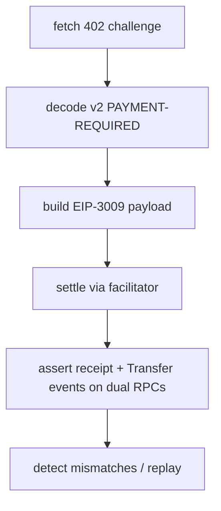
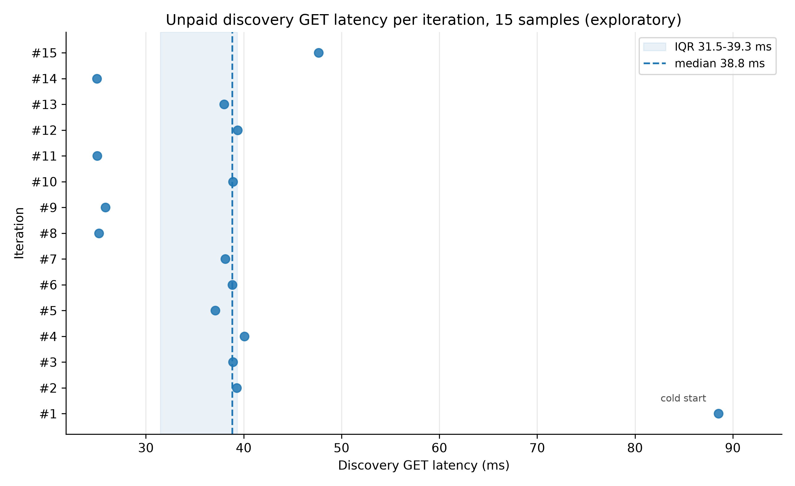

<p align="center">
  <a href="https://github.com/clouatre-labs/x402-buyer-verification/blob/main/LICENSE"></a>
  <a href="https://conventionalcommits.org"></a>
  <a href="RESULTS.md"></a>
  <a href="https://doi.org/10.5281/zenodo.24024416"></a>
</p>

<h1 align="center">x402-buyer-verification</h1>

## For blog readers

This work is written up at [Verify x402 endpoints](https://clouatre.ca/posts/verify-x402-endpoints/).

We verified x402 v2 payment settlement and hostile-seller detection on Base. Two
on-chain traces back this work: a fresh $0.01 USDC settlement from this repo's
Experiment 1 on 2026-11-06
([0xa3143d...f201c](https://basescan.org/tx/0xa3143d32319392227c017ce86dceb2a8e377b7e4f32c21f2693a6925e91f201c))
and prior evidence from 2026-11-03, re-verified read-only,
([0xc6e56a...b9d6](https://basescan.org/tx/0xc6e56a3e0f902ec963aeb4cb6b912bf95ba8188860c840c79fa33d12f368b9d6)).
The first run is a new payment executed for this repository; the second is an
earlier settlement we checked again without spending. Disclosure: the authors
are affiliated with aptu.dev, and Experiment 1 verifies our own endpoint.

Buyer-side verification of x402 v2 payments on Base mainnet, executed as
scripted protocol runs. Three experiments cover a fresh $0.01
mainnet happy-path settlement (paid run 1.11 s, tx
`0xa3143d32319392227c017ce86dceb2a8e377b7e4f32c21f2693a6925e91f201c`),
hostile-seller failure detection (4/4 correct, including a same-nonce
EIP-3009 replay that reverted with `FiatTokenV2: authorization is used or
canceled` on an Anvil fork pinned at block 54035433), and decode-only
probing of third-party endpoints (2/3 v2-compatible; agent402.tools
returned 404). Every reported number traces to a committed `analysis.json`
and raw data under `experiments/*/`.

## Verification chain



*Figure 1: buyer-side x402 verification chain exercised by all three experiments. Each step maps to code: fetch and decode in `experiments/echo-verify/verify.ts` (decode-only dry run via `--skip-pay`), EIP-3009 payload build and facilitator settle in the same runner, receipt plus dual-RPC Transfer-event assertion in `verify.ts`, and mismatch/replay detection in `experiments/mock-seller/probe.ts` and `experiments/mock-seller/replay.ts`.*

## Experiment Index

| Slug | Question | Status | Key Result |
|------|----------|--------|------------|
| `echo-verify` | Does a fresh $0.01 mainnet settlement verify end-to-end? | analyzed | settled 0.01 USDC exactly to payTo per Transfer events on two RPCs |
| `mock-seller` | Are hostile-seller failure modes detected? | analyzed | 4/4 detections correct; replay reverted at EVM level |
| `preflight-external` | Are third-party x402 endpoints v2-compatible? | analyzed | 2/3 v2 challenges; agent402.tools 404 divergence |

*Table 1: experiment index with headline results.*

Derived per-experiment reports live in [results/](results/); full numbers in
[RESULTS.md](RESULTS.md).

Experiment 3 (`preflight-external`) is a decode-only compatibility probe with a
hard no-payment guard: zero payment headers are sent, and the guard trips on
0 paid requests.

| Mode | Detected | How |
|------|----------|-----|
| amount-mismatch | yes | challenge amount 99999 vs manifest 10000 (~10x) caught by decode cross-check |
| payTo-mismatch | yes | challenge payTo 0x2693... vs manifest 0x1693... (single-hex swap) caught by decode cross-check |
| receipt-missing-key | yes | receipt missing `settledAmountUsdc` caught by receipt cross-check |
| replayed-nonce | yes | same-nonce EIP-3009 replay reverted at EVM level: `FiatTokenV2: authorization is used or canceled` (fork-local, Anvil at block 54035433) |

*Table 2: hostile-seller failure modes and detection outcomes; baseline control passed clean. Values copied verbatim from [experiments/mock-seller/data/](experiments/mock-seller/data/).*

## Discovery latency



*Figure 2: unpaid discovery GET latency per iteration across 15 committed samples in run order (median 38.8 ms, IQR 31.5-39.3 ms shown as median line and shaded IQR band in legend). Exploratory (post-hoc).*

## Repository Layout

- `experiments/` - one directory per experiment (protocol, runner, data, analysis.json)
- `results/` - derived per-experiment reports
- `figures/` - rendered figures plus committed matplotlib source
- [METHODOLOGY.md](METHODOLOGY.md) - shared experimental design contract
- [DATA_DICTIONARY.md](DATA_DICTIONARY.md) - schema for `analysis.json`
- [CITATION.cff](CITATION.cff) - citation metadata

## Reproduction

```sh
bun install
uv run python validate_schema.py --self-test
uv run python validate_schema.py

# echo-verify: decode-only dry run (no settlement)
bun experiments/echo-verify/verify.ts --skip-pay
# full run settles ~0.01 USDC; requires MAINNET_PAYER_PRIVATE_KEY in env
bun experiments/echo-verify/verify.ts

# mock-seller and preflight-external
bun experiments/mock-seller/probe.ts
bun experiments/preflight-external/probe.ts

# regenerate Figure 2 from committed samples
uv run --with matplotlib figures/fig1-discovery-latency.py
```

## Reproducibility expectations

- The paid echo-verify settlement is n = 1: a single irreversible $0.01
  mainnet transaction, not a repeated benchmark.
- The mock-seller replay runs on an Anvil fork pinned at block 54035433
  for determinism; fork state is synthetic, so the revert demonstrates
  EVM nonce semantics, not live facilitator behavior.
- Over time, expect degradation: free public RPC endpoints rate-limit,
  and aptu.dev is an unversioned external dependency whose manifests may
  change. Third-party endpoint responses were captured on 2026-11-06 and
  are not guaranteed to reproduce later.

## Citing This Work

See [CITATION.cff](CITATION.cff) or:

```bibtex
@dataset{clouatre2026x402buyerverification,
  title  = {x402 Buyer Verification},
  author = {Clouâtre, Hugues},
  year   = {2026},
  doi    = {10.5281/zenodo.24024416},
  note   = {All versions. Latest version DOI: \url{https://doi.org/10.5281/zenodo.24024417}}
}
```

Dataset archived at Zenodo (concept DOI): [10.5281/zenodo.24024416](https://doi.org/10.5281/zenodo.24024416); latest version: [10.5281/zenodo.24024417](https://doi.org/10.5281/zenodo.24024417).
