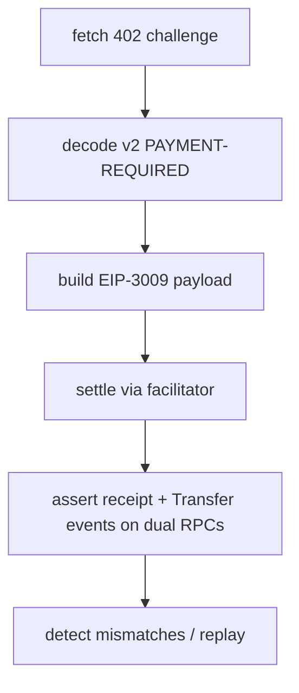

<p align="center">
  <a href="https://github.com/clouatre-labs/x402-buyer-verification/blob/main/LICENSE"></a>
  <a href="https://conventionalcommits.org"></a>
  <a href="RESULTS.md"></a>
</p>

<h1 align="center">x402-buyer-verification</h1>

Buyer-side verification of x402 v2 payments on Base mainnet, executed as
scripted, pre-registered protocol runs. Three experiments cover a fresh $0.01
mainnet happy-path settlement (paid run 1.11 s, tx
`0xa3143d32319392227c017ce86dceb2a8e377b7e4f32c21f2693a6925e91f201c`),
hostile-seller failure detection (4/4 correct, including a same-nonce
EIP-3009 replay that reverted with `FiatTokenV2: authorization is used or
canceled` on an Anvil fork pinned at block 54035433), and decode-only
probing of third-party endpoints (2/3 v2-compatible; agent402.tools
returned 404). Every reported number traces to a committed `analysis.json`
and raw data under `experiments/*/`.

## Verification chain



*Figure 1: buyer-side x402 verification chain exercised by all three experiments.*

## Experiment Index

| Slug | Question | Status | Key Result |
|------|----------|--------|------------|
| `echo-verify` | Does a fresh $0.01 mainnet settlement verify end-to-end? | analyzed | settled 0.01 USDC exactly to payTo per Transfer events on two RPCs |
| `mock-seller` | Are hostile-seller failure modes detected? | analyzed | 4/4 detections correct; replay reverted at EVM level |
| `preflight-external` | Are third-party x402 endpoints v2-compatible? | analyzed | 2/3 v2 challenges; agent402.tools 404 divergence |

*Table 1: pre-registered experiment index with headline results.*

Derived per-experiment reports live in [results/](results/); full numbers in
[RESULTS.md](RESULTS.md).

## Discovery latency


*Figure 2: unpaid discovery GET latency per iteration across 15 committed samples, sorted largest on top (median 0.0388 s, IQR 0.0315-0.0393 s; red lines mark the median and IQR bounds). Exploratory (post-hoc).*

## Repository Layout

- `experiments/` - one directory per pre-registered experiment (protocol, runner, data, analysis.json)
- `results/` - derived per-experiment reports
- `figures/` - rendered figures plus committed matplotlib source
- [METHODOLOGY.md](METHODOLOGY.md) - shared experimental design contract
- [DATA_DICTIONARY.md](DATA_DICTIONARY.md) - schema for `analysis.json`
- [CITATION.cff](CITATION.cff) - citation metadata

## Reproduction

```sh
bun install
uv run python validate_schema.py --self-test
uv run python validate_schema.py

# echo-verify: decode-only dry run (no settlement)
bun experiments/echo-verify/verify.ts --skip-pay
# full run settles ~0.01 USDC; requires MAINNET_PAYER_PRIVATE_KEY in env
bun experiments/echo-verify/verify.ts

# mock-seller and preflight-external
bun experiments/mock-seller/probe.ts
bun experiments/preflight-external/probe.ts

# regenerate Figure 2 from committed samples
uv run python figures/fig1-discovery-latency.py
```

## Reproducibility expectations

- The paid echo-verify settlement is n = 1: a single irreversible $0.01
  mainnet transaction, not a repeated benchmark.
- The mock-seller replay runs on an Anvil fork pinned at block 54035433
  for determinism; fork state is synthetic, so the revert demonstrates
  EVM nonce semantics, not live facilitator behavior.
- Over time, expect degradation: free public RPC endpoints rate-limit,
  and aptu.dev is an unversioned external dependency whose manifests may
  change. Third-party endpoint responses were captured on 2026-11-06 and
  are not guaranteed to reproduce later.

## Citing This Work

See [CITATION.cff](CITATION.cff). A Zenodo DOI is deferred; cite the
repository and version 1.0.0 for now.
